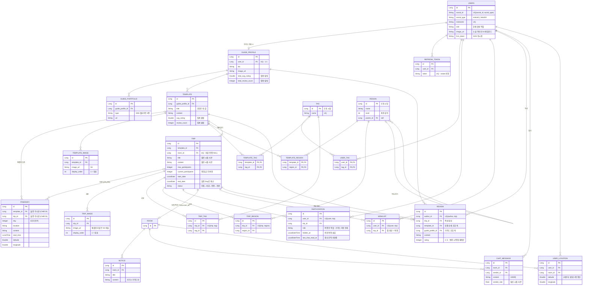

# Trip Agora ERD (mermaid)

> 테이블 23개 · MySQL 8. 공통 컬럼 `created_at` / `modified_at`(JPA Auditing)은 지면상 생략.
> 상세 DDL·제약·enum은 [`TripAgora_ERD.md`](../TripAgora_ERD.md) 참조.

### 읽는 포인트

- **USERS ↔ GUIDE_PROFILE (1:0..1)** — 여행자로 가입, 가이드 전환 시 프로필 생성. 재전환해도 재사용.
- **TEMPLATE → TRIP → ROOM** — 상품 원형(TEMPLATE)에서 여러 날짜의 여행을 열고, 방(ROOM)은 모집 마감 시(가이드의 마감 또는 시작일 00:00 자동 마감)에만 생성. 방 외래 키는 여행 쪽(`trip.room_id`)에 있어 여행 행만 읽어도 방 유무를 안다.
- **여행 = 열린 시점의 사본** — 제목·소개(TRIP), 이미지·태그·지역(TRIP_IMAGE·TRIP_TAG·TRIP_REGION), 일정(ITINERARY의 여행 행)은 여행을 열 때 템플릿에서 복사한다. 템플릿을 고쳐도 열린 여행은 변하지 않는다. 이미지 파일은 복사하지 않고 같은 S3 주소를 쓴다.
- **ITINERARY** 는 템플릿 일정과 여행 일정을 한 테이블에 두고, `chk_itinerary_owner` CHECK로 한 행이 둘 중 정확히 하나에만 속하게 한다.
- **PARTICIPATION.role** 은 여행 안 역할(가이드 자동 등록). 채팅·위치·공지·SOS 인가의 근거. 완료 여행 취소는 행을 지우지 않고 `hidden_at`만 채운다.
- **REVIEW** 는 trip·template·guide_profile 세 축을 모두 직접 참조 — 조회 축(상품/가이드)마다 조인 없이 접근. 평점 집계 컬럼은 리뷰 변경 시 DB 집계 쿼리로 다시 계산.
- **REGION** 은 self-reference로 부모(서울)–자식(강남구) 2단 계층.
