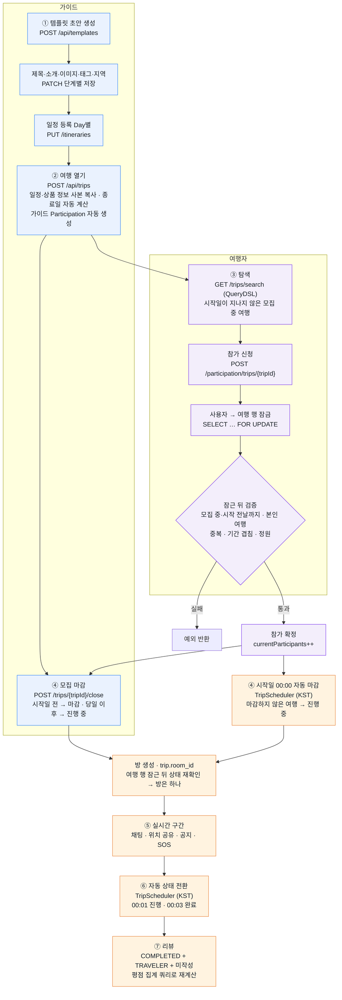
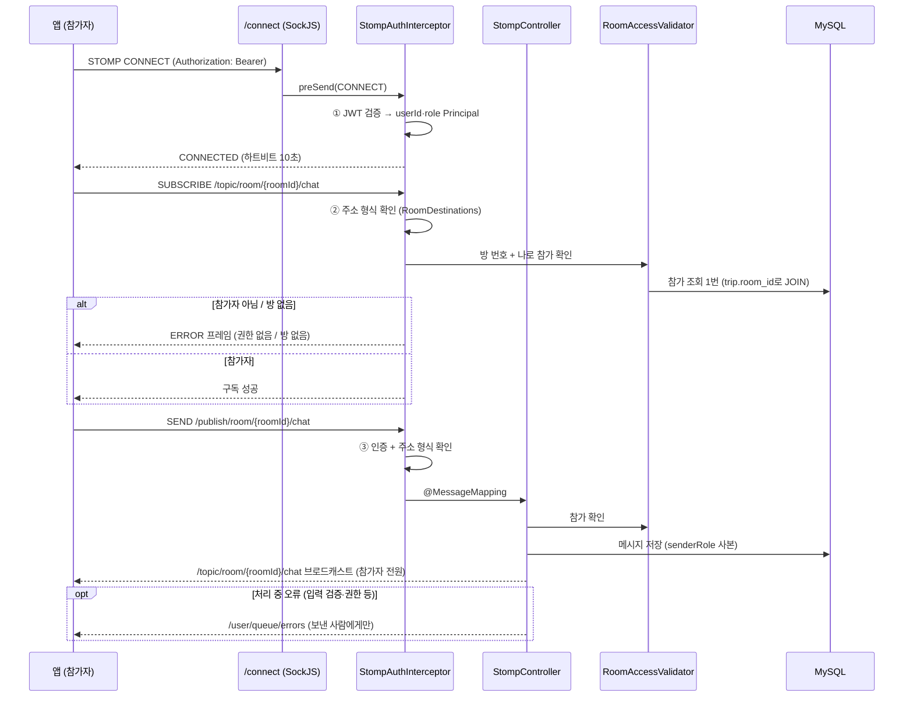
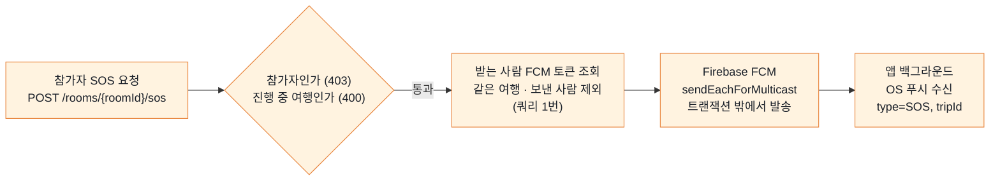

# Trip Agora 핵심 플로우 (mermaid)

> 여행 라이프사이클 × 실시간 통신 파이프라인. 단계별 상세는 [`TripAgora_trip_realtime_flow.md`](../TripAgora_trip_realtime_flow.md) 참조.

## 1. 전체 파이프라인

## 2. 실시간 구간 — STOMP 프레임별 인가

> 위치 공유도 같은 경로다(`/publish/room/{roomId}/location` → 최신 위치 저장·갱신 → `/topic/room/{roomId}/location`). 내 오류 큐 `/user/queue/errors` 구독은 로그인만 확인한다.

## 3. SOS는 STOMP가 아닌 FCM

> STOMP 브로드캐스트는 소켓이 연결된(화면을 보고 있는) 참가자에게만 닿는다. 긴급 신호는 앱을 보고 있지 않은 사람에게도 도달해야 하므로 OS 레벨 푸시(FCM)를 사용한다. 외부 호출 동안 DB 커넥션을 잡지 않도록 조회를 마친 뒤 발송하고, 발송 실패는 로그만 남긴다.
